# nanoMuse 侧边栏导航功能后端实现分析

> 分析日期: 2026-11-04  
> 分析对象: 侧边栏导航图标对应的后端功能实现  
> 源码位置: `nanomuse/server/`, `nanomuse/goals/`, `nanomuse/memory/`, `nanomuse/hub/`

---

## 一、后端架构总览

侧边栏的每个导航项都对应着后端的一套完整服务：数据存储、API 端点、业务逻辑。

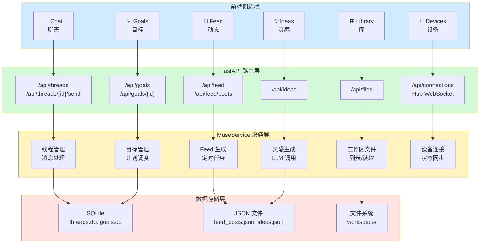

---

## 二、核心数据模型

### 2.1 状态快照 (State Snapshot)

后端通过 `state()` 方法向前端发送完整状态，包含所有侧边栏功能的数据：

```python
# nanomuse/server/service.py
def state(self) -> dict[str, Any]:
    return {
        "version": __version__,
        "profile": self.profile.to_dict(),           # Agent 配置
        "status": self.ui.overall_status(),          # 运行状态
        "threads": [t.meta() for t in self.visible_threads()],  # 聊天线程
        "pending_approvals": [...],                  # 待审批 (Chat 徽章)
        "goals": [goal_to_dict(g) for g in self.app.goals.list()],  # 目标列表
        "settings": self.settings_view(),            # 设置
        "hub": self.hub.view(),                      # 设备信息 (Devices)
        # ...
    }
```

### 2.2 数据流图

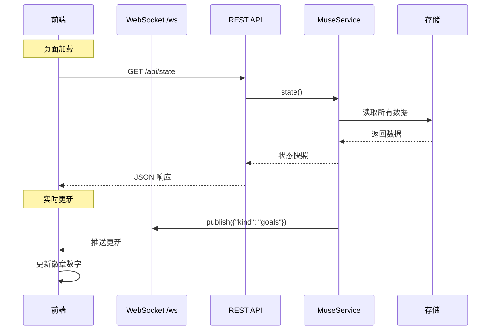

---

## 三、Chat (聊天) 后端实现

### 3.1 架构

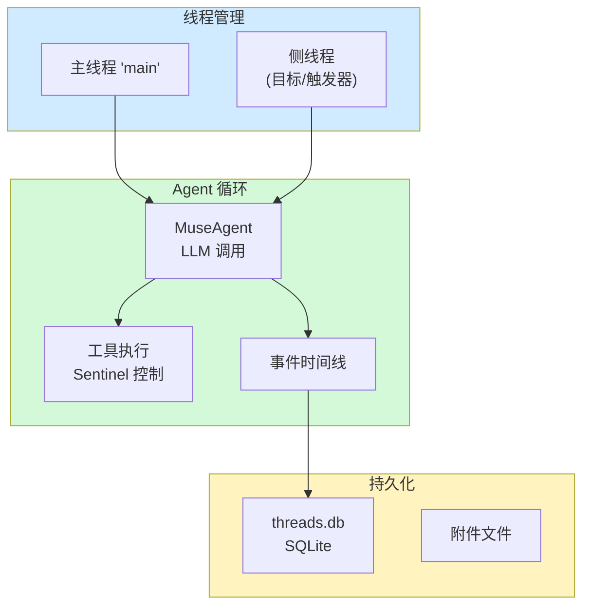

### 3.2 核心数据结构

```python
# nanomuse/server/service.py
@dataclass
class Thread:
    id: str                    # 线程 ID，主线程为 "main"
    title: str                 # 显示标题
    created_at: str           # 创建时间
    updated_at: str           # 更新时间
    timeline: Timeline        # 事件时间线 (消息、工具调用、审批)
    agent: MuseAgent          # 绑定到线程的 Agent 实例
    inbox: asyncio.Queue      # 消息队列 (异步处理)
    worker: asyncio.Task      # 后台工作协程
    busy: bool                # 是否正在处理
    purposes: dict            # 后台任务标签 (如 "goal work")
    device: str | None        # 目标设备 (跨设备聊天)
```

### 3.3 API 端点

```python
# nanomuse/server/api.py
POST /api/threads              # 创建新线程
GET  /api/threads              # 列出所有线程
GET  /api/threads/{id}/events  # 获取时间线事件 (?limit&before)
POST /api/threads/{id}/send    # 发送消息 (非阻塞)
POST /api/approvals/{id}       # 审批工具调用
```

### 3.4 消息处理流程

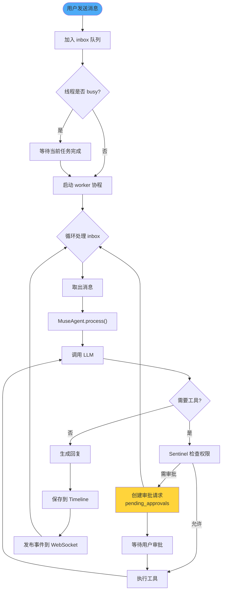

### 3.5 徽章数据来源

Chat 图标的徽章显示 `pendingApprovals`，来自：

```python
# 从 state() 中提取待审批列表
"pending_approvals": [
    ev for t in self.visible_threads()
    for ev in t.timeline.events
    if ev.get("type") == "approval" and ev.get("status") == "pending"
]
```

---

## 四、Feed (动态) 后端实现

### 4.1 架构

Feed 是 Agent 主动为用户生成的内容，无需用户请求。

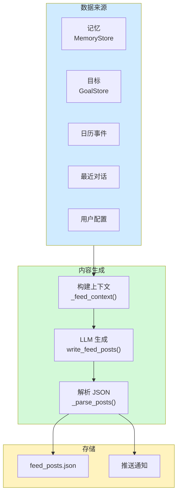

### 4.2 数据模型

```python
# feed_posts.json 结构
{
    "instructions": "用户自定义的 Feed 偏好",
    "daily": true,                    # 是否每日生成
    "time": "08:00",                  # 生成时间 (本地时间)
    "generated_at": "2026-11-04T00:00:00Z",  # 上次生成时间
    "posts": [
        {
            "id": "post_xxx",
            "title": "标题 (最多10词)",
            "body": "Markdown 正文 (60-160词)",
            "area": "planning|research|goals|...",
            "prompt": "后续问题",
            "ts": "时间戳"
        }
    ]
}
```

### 4.3 定时生成逻辑

```python
# nanomuse/server/service.py
def feed_posts_due(self) -> bool:
    """判断是否需要生成新的 Feed"""
    if self._writing_feed:
        return False
    data = self.feed_posts()
    if not data["daily"]:
        return False
    
    # 需要有足够的内容才能生成
    known = (
        bool(data["instructions"])
        or bool(self.app.goals.list("active"))
        or bool(self.connections.data.get("onboarded"))
    )
    if not known and self.app.memory is not None:
        known = self.app.memory.count() >= 5
    
    if not known:
        return False
    
    # 检查是否到了生成时间
    last = data.get("generated_at")
    # ... 时间计算逻辑
    return written < self.feed_scheduled_at()

async def write_feed_posts(self, n: int = 3) -> dict[str, Any]:
    """生成新的 Feed 帖子"""
    # 1. 构建上下文
    context = self._feed_context()  # 记忆、目标、日历、最近对话
    
    # 2. 调用 LLM
    prompt = FEED_PROMPT.format(
        name=self.profile.name,
        n=n,
        instructions=data["instructions"],
        context="\n".join(context),
        language=self.feed_language(),
    )
    response = await self.app.llm.ask_complete([Message.user(prompt)])
    
    # 3. 解析并保存
    posts = _parse_posts(response.content)
    data["posts"] = [*posts, *data["posts"]]
    self._save_feed(data)
    
    # 4. 发送推送通知
    self.push.notify(...)
```

### 4.4 Feed 聚合 API

```python
def feed(self, limit: int = 60) -> list[dict[str, Any]]:
    """聚合所有后台活动，不仅是 Feed 帖子"""
    items = []
    for t in self.threads.values():
        items.extend(self._feed_of(t))  # 从每个线程提取后台事件
    items.sort(key=lambda i: i["ts"], reverse=True)
    return items[:limit]

def _feed_of(self, t: Thread) -> list[dict[str, Any]]:
    """从线程中提取后台事件"""
    # 包括：
    # - 后台任务的结果 (background)
    # - 生成的文件 (artifact)
    # - 待审批请求 (approval)
    # - Agent 问题 (question)
```

### 4.5 API 端点

```python
GET  /api/feed              # 获取聚合的 Feed 事件
GET  /api/feed/posts        # 获取生成的帖子和配置
PUT  /api/feed/instructions # 设置 Feed 偏好
POST /api/feed/posts/refresh # 立即生成新帖子
```

---

## 五、Ideas (灵感) 后端实现

### 5.1 架构

Ideas 是 Agent 基于用户数据生成的个性化建议。

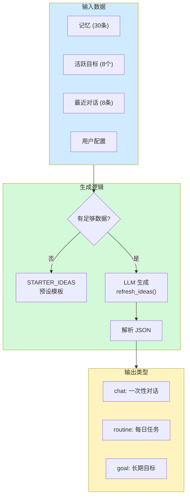

### 5.2 预设灵感模板

```python
# nanomuse/server/service.py
STARTER_IDEAS = [
    {
        "title": "Plan my week",
        "detail": "Tell me what's on your plate and I'll turn it into a realistic plan.",
        "prompt": "Help me plan my week. Ask me what I need to get done...",
        "area": "planning",
        "kind": "chat",
    },
    {
        "title": "A morning brief",
        "detail": "Before you leave each morning: the weather, the first thing...",
        "prompt": "Morning brief: check today's weather...",
        "area": "planning",
        "kind": "routine",
        "time": "07:30",
    },
    # ... 更多模板
]
```

### 5.3 数据结构

```python
# ideas.json 结构
{
    "generated_at": "2026-11-04T00:00:00Z",
    "source": "model" | "starter",  # 来源：LLM 生成或预设
    "ideas": [
        {
            "title": "标题 (最多8词)",
            "detail": "描述 (最多300字符)",
            "prompt": "点击后发送的消息",
            "area": "planning|research|goals|money|health|home|learning|people|files|fun",
            "kind": "chat|routine|goal",
            "time": "HH:MM (仅 routine)",
            "category": "goals 专用类别"
        }
    ]
}
```

### 5.4 生成逻辑

```python
async def refresh_ideas(self, n: int = 5) -> dict[str, Any]:
    """生成个性化灵感"""
    # 1. 收集上下文
    context_lines = []
    if self.app.memory is not None:
        for m in self.app.memory.all(limit=30):
            context_lines.append(f"- memory ({m.category}): {m.content}")
    for g in self.app.goals.list("active")[:8]:
        context_lines.append(f"- goal: {g.title} ...")
    # ... 添加最近对话
    
    # 2. 无数据时返回预设
    if not context_lines:
        data = {"generated_at": now_iso(), "source": "starter", "ideas": STARTER_IDEAS}
        self._ideas_file().write_text(json.dumps(data), "utf-8")
        return data
    
    # 3. 调用 LLM 生成
    prompt = IDEAS_PROMPT.format(
        name=self.profile.name,
        n=n,
        context="\n".join(context_lines),
        language=self.feed_language(),
    )
    response = await self.app.llm.ask_complete([Message.user(prompt)])
    ideas = _parse_ideas(response.content)
    
    # 4. 保存并返回
    data = {
        "generated_at": now_iso(),
        "source": "model" if ideas else "starter",
        "ideas": ideas or STARTER_IDEAS,
    }
    self._ideas_file().write_text(json.dumps(data), "utf-8")
    return data
```

### 5.5 API 端点

```python
GET /api/ideas            # 获取灵感列表 (?refresh=1 强制刷新)
```

---

## 六、Goals (目标) 后端实现

### 6.1 架构

Goals 是长期任务跟踪系统，支持步骤分解、进度追踪和计划调整。

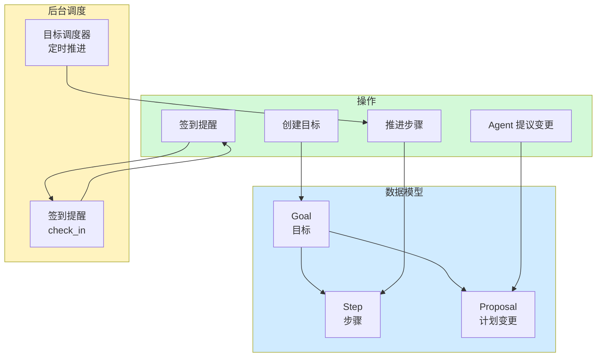

### 6.2 数据模型

```python
# nanomuse/goals/store.py
@dataclass
class Goal:
    id: str
    title: str
    description: str
    status: str              # active | paused | done | cancelled
    created_at: str
    updated_at: str
    steps: list[Step]        # 步骤列表
    notes: str               # 备注
    category: str            # health|finance|career|learning|...
    due: str                 # 截止日期 (ISO date)
    check_in: str            # 签到频率 (daily|weekdays|weekly|monthly)
    next_check_in: str       # 下次签到时间
    proposal: dict | None    # 待审批的计划变更

@dataclass
class Step:
    id: str
    goal_id: str
    idx: int                 # 顺序
    title: str
    status: str              # pending|in_progress|done|blocked|skipped
    note: str
    updated_at: str
```

### 6.3 数据库 Schema

```sql
-- nanomuse/goals/store.py
CREATE TABLE IF NOT EXISTS goals (
    id TEXT PRIMARY KEY,
    title TEXT NOT NULL,
    description TEXT NOT NULL DEFAULT '',
    status TEXT NOT NULL DEFAULT 'active',
    notes TEXT NOT NULL DEFAULT '',
    created_at TEXT NOT NULL,
    updated_at TEXT NOT NULL
);

CREATE TABLE IF NOT EXISTS steps (
    id TEXT PRIMARY KEY,
    goal_id TEXT NOT NULL REFERENCES goals(id) ON DELETE CASCADE,
    idx INTEGER NOT NULL,
    title TEXT NOT NULL,
    status TEXT NOT NULL DEFAULT 'pending',
    note TEXT NOT NULL DEFAULT '',
    updated_at TEXT NOT NULL
);
```

### 6.4 签到调度

```python
def next_check_in(spec: str, after: datetime | None = None) -> datetime | None:
    """计算下次签到时间"""
    parsed = parse_check_in(spec)
    if parsed is None:
        return None
    cadence, anchor, hour, minute = parsed
    now = (after or datetime.now()).astimezone()
    
    for _ in range(62):  # 扫描两个月
        candidate = datetime(day.year, day.month, day.day, hour, minute, tzinfo=now.tzinfo)
        fits = (
            cadence == "daily"
            or (cadence == "weekdays" and day.weekday() < 5)
            or (cadence == "weekly" and day.weekday() == anchor)
            or (cadence == "monthly" and day.day == (anchor or 1))
        )
        if fits and candidate > now:
            return candidate
        day += timedelta(days=1)
    return None
```

### 6.5 API 端点

```python
GET    /api/goals                        # 列出目标 (?status&category)
POST   /api/goals                        # 创建目标
GET    /api/goals/{id}                   # 获取单个目标
PATCH  /api/goals/{id}                   # 更新目标
DELETE /api/goals/{id}                   # 删除目标
POST   /api/goals/{id}/advance           # 推进到下一步
POST   /api/goals/{id}/steps             # 添加步骤
POST   /api/goals/{id}/check-in          # 签到
POST   /api/goals/{id}/proposal/accept   # 接受计划变更
DELETE /api/goals/{id}/proposal          # 拒绝计划变更
```

### 6.6 徽章数据来源

Goals 图标的徽章显示 `proposals` (待审批的计划变更数量)：

```python
proposals = state.goals.filter((g) => g.proposal && g.status !== "cancelled").length;
```

---

## 七、Library (库) 后端实现

### 7.1 架构

Library 展示 Agent 工作区中的文件，分为 Artifacts (文档) 和 Media (媒体)。

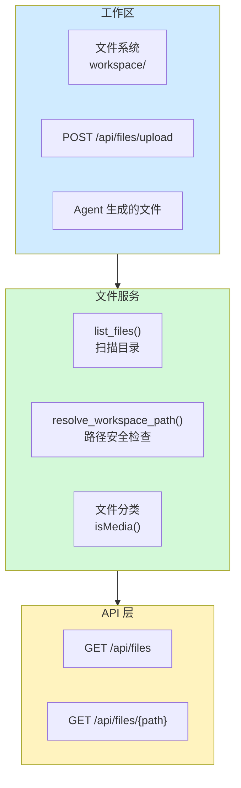

### 7.2 文件扫描逻辑

```python
# nanomuse/server/service.py
def list_files(self, limit: int = 200) -> list[dict[str, Any]]:
    """列出工作区中的所有文件"""
    ws = self.workspace()
    out = []
    
    if not ws.exists():
        return out
    
    for p in ws.rglob("*"):
        # 跳过隐藏文件
        if not p.is_file() or any(part.startswith(".") for part in p.relative_to(ws).parts):
            continue
        try:
            st = p.stat()
        except OSError:
            continue
        
        out.append({
            "path": p.relative_to(ws).as_posix(),
            "name": p.name,
            "size": st.st_size,
            "modified": datetime.fromtimestamp(st.st_mtime, UTC).isoformat(timespec="seconds"),
        })
        if len(out) >= 5000:
            break
    
    # 按修改时间倒序
    out.sort(key=lambda f: f["modified"], reverse=True)
    return out[:limit]

def resolve_workspace_path(self, rel: str) -> Path:
    """安全解析路径，防止目录遍历"""
    ws = self.workspace()
    target = (ws / rel).resolve()
    if target != ws and ws not in target.parents:
        raise PermissionError("path outside the workspace")
    return target
```

### 7.3 前端分类逻辑 (参考)

```typescript
// 前端根据扩展名分类
const MEDIA_EXT = new Set([
    "png", "jpg", "jpeg", "gif", "webp", "svg", "heic",  // 图片
    "mp3", "wav", "m4a", "ogg", "flac",                   // 音频
    "mp4", "mov", "webm", "mkv"                           // 视频
]);

function isMedia(name: string): boolean {
    return MEDIA_EXT.has(name.toLowerCase().split(".").pop() ?? "");
}
```

### 7.4 API 端点

```python
GET  /api/files              # 列出文件 (?limit=200)
GET  /api/files/{path}       # 获取文件内容
POST /api/files/upload       # 上传文件 (?name=)
```

---

## 八、Devices (设备) 后端实现

### 8.1 架构

Devices 通过 Hub 系统管理账户下的所有设备，支持跨设备通信。

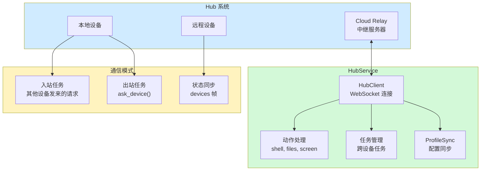

### 8.2 HubService 核心

```python
# nanomuse/hub/service.py
class HubService:
    def __init__(self, svc: MuseService):
        self.svc = svc
        self.client: HubClient | None = None
        self.cloud = CloudClient(...)
        
        # 设备状态
        self._devices_seen: dict[str, bool] | None = None  # 在线状态
        
        # 跨设备任务
        self.remote_approvals: dict = {}    # 其他设备的审批
        self._relayed_approvals: dict = {}  # 本设备的审批
        
        # 配置同步
        self.profile = ProfileSync(self)
```

### 8.3 设备视图数据

```python
# nanomuse/hub/service.py
def view(self) -> dict[str, Any]:
    return {
        "enabled": self.settings.hub.enabled,
        "account": {
            "signed_in": self.signed_in,
            "email": self.settings.hub.email,
            # ...
        },
        "devices": [
            {
                "id": device["id"],
                "name": device["name"],
                "kind": device["kind"],      # desktop | phone | web
                "online": device["online"],
                "this": device["id"] == self.device_id,  # 是否当前设备
            }
            for device in self._devices
        ],
    }
```

### 8.4 跨设备任务流程

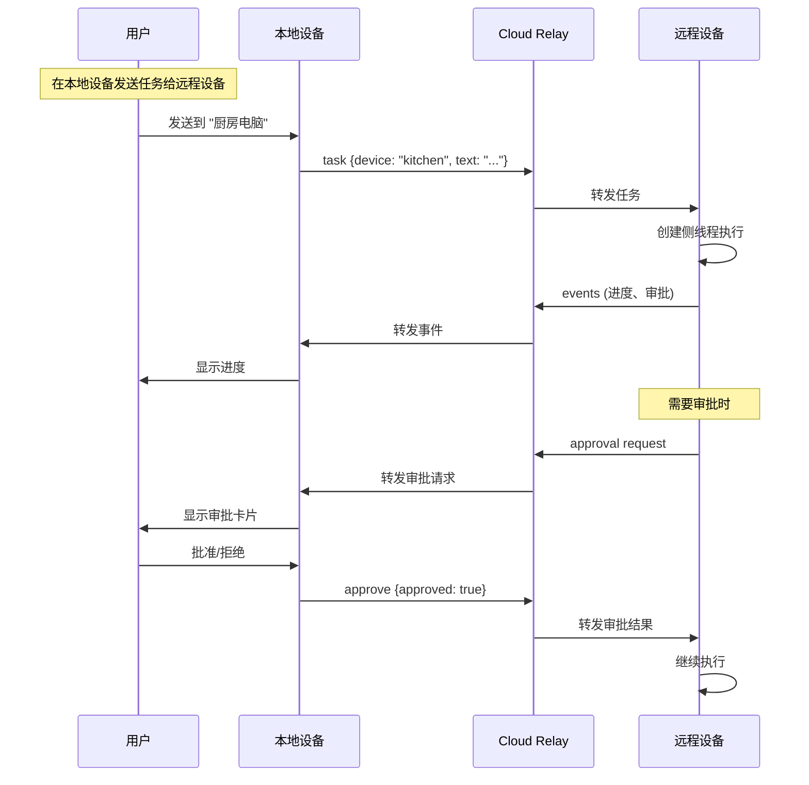

### 8.5 状态点数据来源

Devices 图标的状态点显示 `online` (在线设备数)：

```python
# 过滤条件：非当前设备、非 web 类型、在线
online = [d for d in state.hub.devices 
          if not d.this and d.kind != "web" and d.online]
```

### 8.6 API 端点

```python
GET  /api/connections          # 获取连接状态 (包括 Hub)
PUT  /api/connections/gui      # 更新 GUI 配置
# Hub 通过 WebSocket 实时通信
```

---

## 九、Settings (设置) 后端实现

### 9.1 架构

设置系统管理 Agent 配置、安全策略、连接器等。

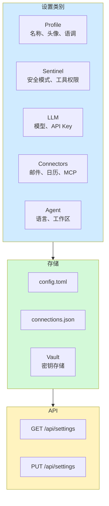

### 9.2 Profile 数据模型

```python
# nanomuse/server/service.py
@dataclass
class Profile:
    name: str = "nanoMuse"           # Agent 名称
    avatar: str = "dragon"           # 头像类型
    emoji: str = "✨"                # 表情符号
    color: str = "#0064d4"           # 主题色
    tagline: str = ""                # 标语
    tone: str = ""                   # 语调 (formal|casual|playful|concise)
    communication: str = ""          # 沟通风格 (short|detailed|bullets)
    style: str = ""                  # 自定义风格
    user_name: str = ""              # 用户称呼
    proactivity: str = "default"     # 主动性 (off|low|default|high)
    goal_interval_minutes: int = 60  # 目标推进间隔
    quiet_hours: str = ""            # 静默时段 ("22:00-08:00")
```

### 9.3 设置视图

```python
def settings_view(self) -> dict[str, Any]:
    s = self.settings
    return {
        "version": __version__,
        "profile": self.profile.to_dict(),
        "sentinel": {
            "mode": s.sentinel.mode,           # ask | strict | auto
            "always_ask_tools": s.sentinel.always_ask_tools,
            "always_allow_tools": s.sentinel.always_allow_tools,
            "deny_tools": s.sentinel.deny_tools,
            "taint_tracking": s.sentinel.taint_tracking,
            "egress_allowlist": s.sentinel.egress_allowlist,
        },
        "sandbox": {
            "mode": s.sandbox.mode,
            "active": self.app.sandbox.active,
            "status": self.app.sandbox.status,
        },
        "llm": {
            "provider": s.llm.provider,
            "model": s.llm.model,
            "stream": s.llm.stream,
            "cloud": bool(...),
        },
        "agent": {
            "language": s.agent.language,
            "max_steps": s.agent.max_steps,
            "show_thinking": s.agent.show_thinking,
            "workspace": str(s.agent.workspace),
        },
        "connectors": {
            "email": s.connectors.email.enabled,
            "calendar": s.connectors.calendar.enabled,
            "contacts": s.connectors.contacts.enabled,
            "browser": s.browser.enabled,
            "gui": s.gui.enabled,
            "hands": s.hands.enabled,
            "mcp": [m.name for m in s.mcp.servers],
        },
        # ...
    }
```

### 9.4 API 端点

```python
GET /api/settings    # 获取所有设置
PUT /api/settings    # 更新设置
```

---

## 十、后端服务关系图

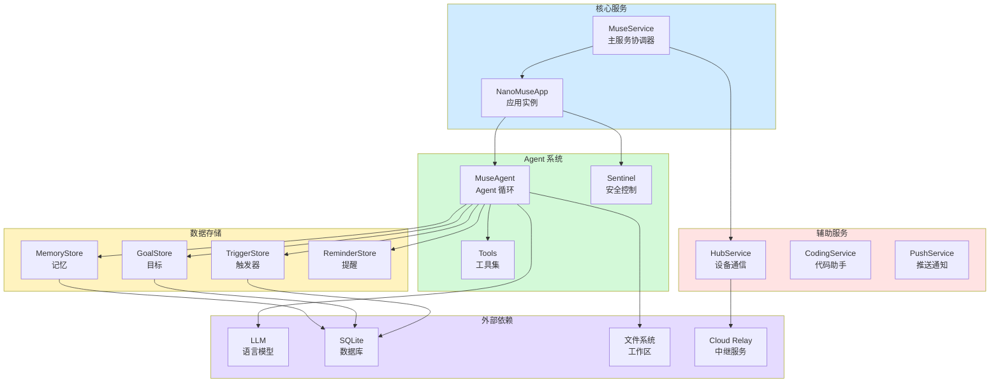

---

## 十一、数据流与状态同步

### 11.1 状态更新机制

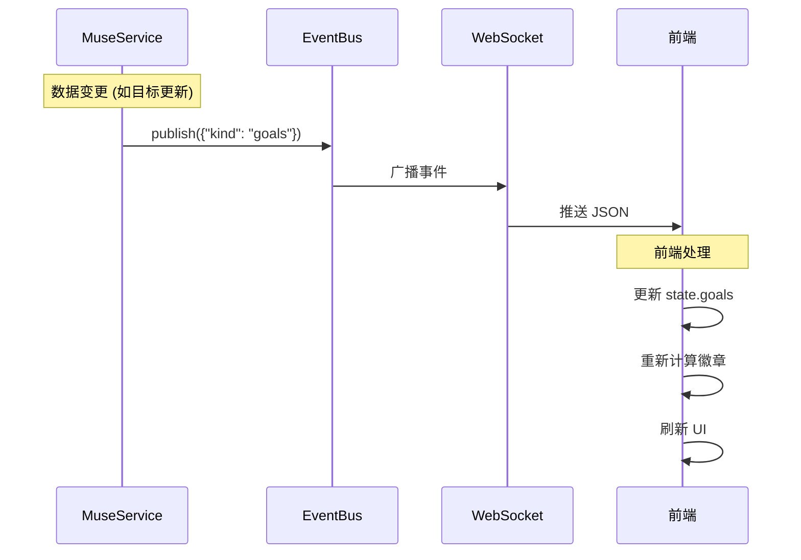

### 11.2 EventBus 事件类型

```python
# 各类事件触发前端更新
{
    "kind": "goals"           # 目标变更 → Goals 徽章
    "kind": "feed_posts"      # Feed 更新 → Feed 徽章
    "kind": "ideas"           # 灵感更新 → Ideas 刷新
    "kind": "settings"        # 设置变更 → Settings 刷新
    "kind": "thread"          # 线程更新 → Chat 刷新
    "kind": "approval"        # 审批请求 → Chat 徽章
}
```

---

## 十二、API 端点汇总

| 功能 | 端点 | 说明 |
|------|------|------|
| **状态** | `GET /api/state` | 完整状态快照 |
| **Chat** | `GET/POST /api/threads` | 线程列表/创建 |
| | `POST /api/threads/{id}/send` | 发送消息 |
| | `POST /api/approvals/{id}` | 审批 |
| **Feed** | `GET /api/feed` | 聚合 Feed |
| | `GET /api/feed/posts` | 生成的帖子 |
| | `PUT /api/feed/instructions` | 设置偏好 |
| | `POST /api/feed/posts/refresh` | 刷新帖子 |
| **Ideas** | `GET /api/ideas` | 灵感列表 |
| **Goals** | `GET/POST /api/goals` | 目标列表/创建 |
| | `PATCH/DELETE /api/goals/{id}` | 更新/删除 |
| | `POST /api/goals/{id}/advance` | 推进 |
| | `POST /api/goals/{id}/check-in` | 签到 |
| **Library** | `GET /api/files` | 文件列表 |
| | `GET /api/files/{path}` | 文件内容 |
| | `POST /api/files/upload` | 上传 |
| **Devices** | `GET /api/connections` | 连接状态 |
| | WebSocket `/ws` | 实时通信 |
| **Settings** | `GET/PUT /api/settings` | 设置读写 |
| | `GET /api/memory` | 记忆列表 |
| | `GET /api/activity` | 活动日志 |

---

## 十三、关键实现要点

### 13.1 异步架构

```python
# 每个线程有独立的异步工作协程
@dataclass
class Thread:
    inbox: asyncio.Queue      # 消息队列
    worker: asyncio.Task      # 工作协程
    busy: bool                # 忙碌状态
```

### 13.2 安全控制

```python
# Sentinel 控制工具权限
class Sentinel:
    mode: str                    # ask | strict | auto
    always_ask_tools: list       # 总是询问的工具
    always_allow_tools: list     # 总是允许的工具
    deny_tools: list             # 禁止的工具
```

### 13.3 LLM 会话管理

```python
# 不同类型的任务使用不同的会话标识
with llm_session.run("feed"):      # Feed 生成
with llm_session.run("goal"):      # 目标推进
with llm_session.run("ideas"):     # 灵感生成
```

---

## 附录

### A. 相关源文件

| 文件 | 说明 |
|------|------|
| `nanomuse/server/service.py` | MuseService 主服务 |
| `nanomuse/server/api.py` | FastAPI 路由 |
| `nanomuse/goals/store.py` | GoalStore 目标存储 |
| `nanomuse/memory/store.py` | MemoryStore 记忆存储 |
| `nanomuse/triggers/store.py` | TriggerStore 触发器存储 |
| `nanomuse/hub/service.py` | HubService 设备通信 |
| `nanomuse/agent/core.py` | MuseAgent Agent 循环 |
| `nanomuse/config.py` | Settings 配置类 |

### B. 数据库文件

| 文件 | 内容 |
|------|------|
| `threads.db` | 线程、消息、审批 |
| `goals.db` | 目标、步骤 |
| `triggers.db` | 触发器 |
| `reminders.db` | 提醒 |
| `memory.db` | 记忆 |

### C. JSON 文件

| 文件 | 内容 |
|------|------|
| `feed_posts.json` | Feed 帖子和配置 |
| `ideas.json` | 灵感列表 |
| `connections.json` | 连接器配置 |
| `firstrun.json` | 首次运行状态 |

---

*报告完成*
