# Rakazo 项目分析报告

> 分析日期: 2026-11-04  
> 项目版本: 0.1.0 (Beta)  
> 源码位置: `rakazo-main/`

---

## 一、项目概述

### 1.1 项目定位

**Rakazo** 是一个开源的 AI Agent 平台，专注于提供持久化的 AI 队友（Persistent Teammates）。它是 Grok Bot、Meta Muse、OpenAI Dots、Claude Duet 等产品的开源、自托管替代品。

**核心理念：**
- **拥有你的 AI 队友**: 用户完全控制自己的 AI 助手
- **持久化状态**: Bot 有独立的对话、记忆、例程和历史
- **自托管优先**: 完整核心产品可在用户自己的基础设施上运行
- **提供商中立**: 不强制绑定任何特定 LLM 或服务商

### 1.2 项目信息

| 属性 | 详情 |
|------|------|
| **开源协议** | Apache-2.0 |
| **主要语言** | TypeScript |
| **作者** | elie222 |
| **GitHub** | https://github.com/elie222/rakazo |
| **官网** | https://rakazo.com |
| **状态** | Beta |
| **包管理器** | pnpm 9.15.0 |
| **Node.js** | ^22.22.2 \|\| ^24.0.0 \|\| >=26.0.0 |

### 1.3 支持平台

| 平台 | 技术栈 | 说明 |
|------|--------|------|
| **Web** | React 19 + Vite | 主要界面 |
| **Desktop** | Electron | 桌面应用 |
| **iOS** | Expo | iPhone 应用 |
| **Android** | Expo | Android 应用 |

---

## 二、项目架构

### 2.1 系统架构图

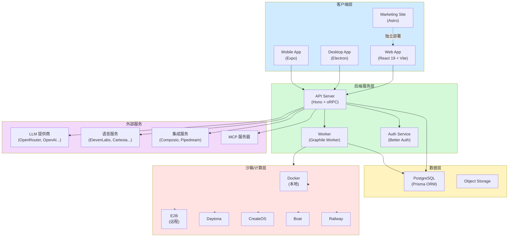

### 2.2 Monorepo 结构

```mermaid
graph TD
    Root["rakazo/"] --> Apps["apps/<br/>应用程序"]
    Root --> Packages["packages/<br/>共享包"]
    Root --> Infra["infra/<br/>基础设施"]
    Root --> Scripts["scripts/<br/>脚本"]

    Apps --> WebApp["web/<br/>Web 应用"]
    Apps --> DesktopApp["desktop/<br/>Electron 桌面"]
    Apps --> MobileApp["mobile/<br/>Expo 移动端"]
    Apps --> ApiApp["api/<br/>API 服务"]
    Apps --> WorkerApp["worker/<br/>后台任务"]
    Apps --> WwwApp["www/<br/>营销网站"]

    Packages --> Core["core/<br/>核心逻辑"]
    Packages --> Contracts["contracts/<br/>类型契约"]
    Packages --> DB["db/<br/>数据库"]
    Packages --> Auth2["auth/<br/>认证"]
    Packages --> Memory["memory/<br/>记忆系统"]
    Packages --> UIWeb["ui-web/<br/>UI 组件"]
    Packages --> UITokens["ui-tokens/<br/>设计令牌"]
    Packages --> ChatUI["chat-ui/<br/>聊天 UI"]
    Packages --> Adapters["adapters/<br/>适配器"]
    Packages --> Testkit["testkit/<br/>测试工具"]

    Infra --> Compose["compose/<br/>Docker Compose"]
    Infra --> Sandboxes["sandboxes/<br/>沙箱配置"]
    Infra --> Railway2["railway/<br/>Railway 部署"]
    Infra --> Systemd["systemd/<br/>Systemd 服务"]

    style Root fill:#4dabf7
    style Apps fill:#51cf66
    style Packages fill:#ffd43b
    style Infra fill:#ff922b
```

### 2.3 核心包关系图

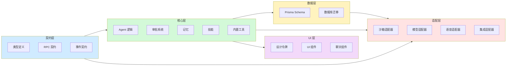

---

## 三、核心功能

### 3.1 功能架构图

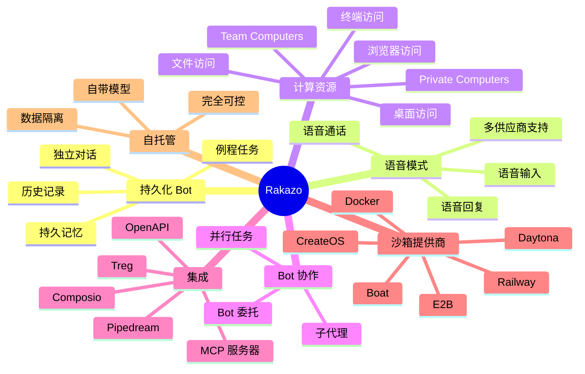

### 3.2 Bot 生命周期

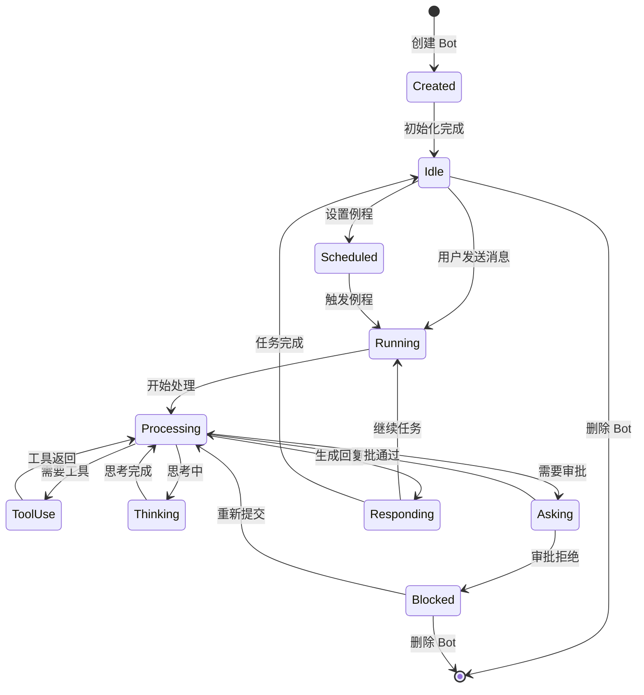

### 3.3 审批流程

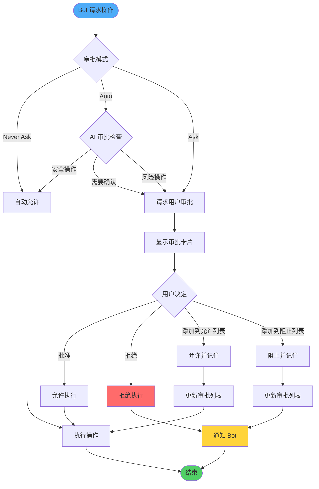

### 3.4 沙箱/计算资源管理

```mermaid
flowchart LR
    subgraph Providers["沙箱提供商"]
        Docker["Docker<br/>(本地)"]
        E2B2["E2B<br/>(云端)"]
        Daytona2["Daytona"]
        CreateOS2["CreateOS"]
        Boat2["Boat"]
        Railway3["Railway"]
    end

    subgraph ComputerTypes["计算机类型"]
        Team["Team Computer<br/>共享资源"]
        Private["Private Computer<br/>隔离资源"]
    end

    subgraph Resources["资源"]
        Browser["浏览器"]
        Terminal["终端"]
        Files["文件系统"]
        Desktop2["桌面环境"]
    end

    subgraph Features["特性"]
        Persistence["持久化状态"]
        Checkpoint["浏览器检查点"]
        Takeover["用户接管"]
        LazyStart["懒启动"]
        AutoRelease["自动释放"]
    end

    Providers --> ComputerTypes
    ComputerTypes --> Resources
    Resources --> Features
    
    style Providers fill:#ffe3e3
    style ComputerTypes fill:#d0ebff
    style Resources fill:#d3f9d8
    style Features fill:#f3d9fa
```

---

## 四、核心流程

### 4.1 消息处理流程

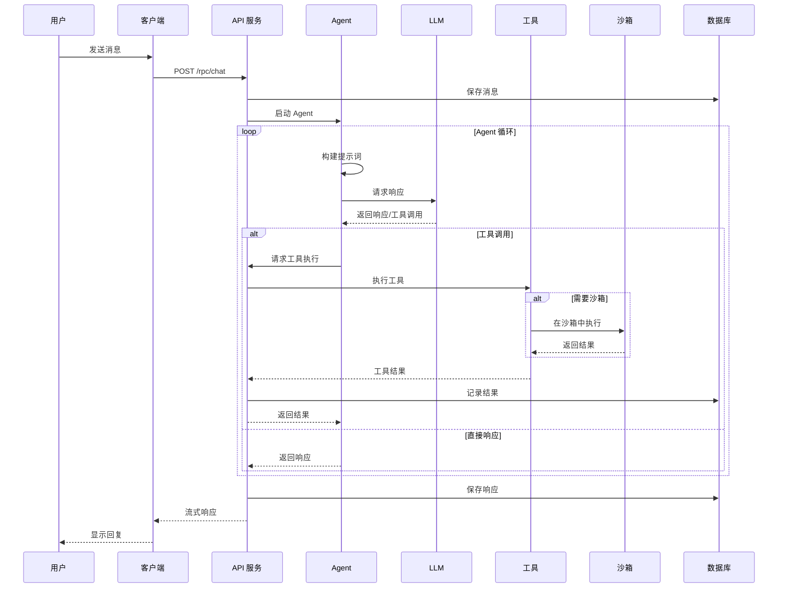

### 4.2 Bot 委托流程

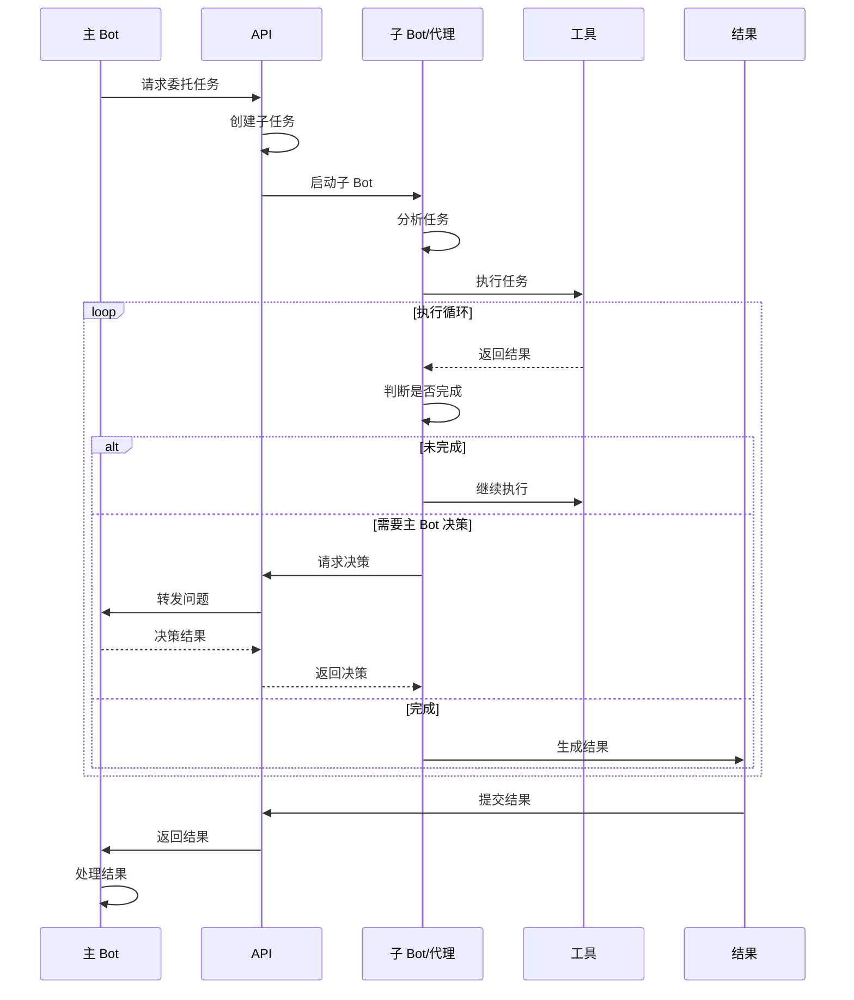

### 4.3 记忆系统流程

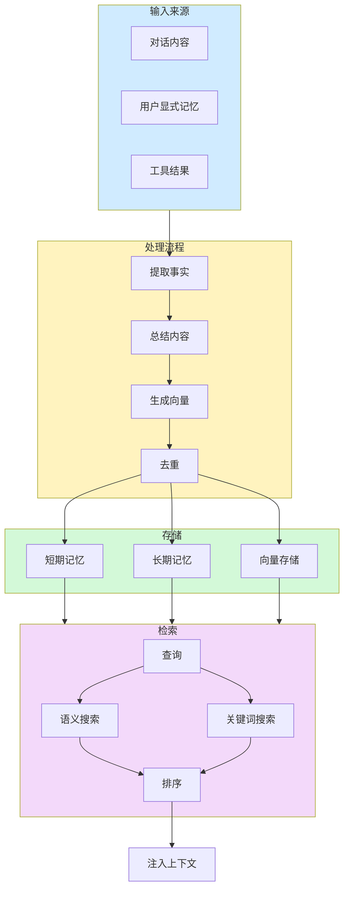

---

## 五、技术栈详解

### 5.1 前端技术栈

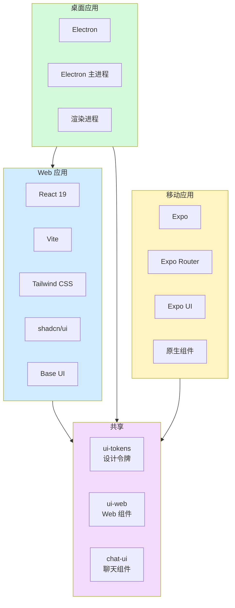

### 5.2 后端技术栈

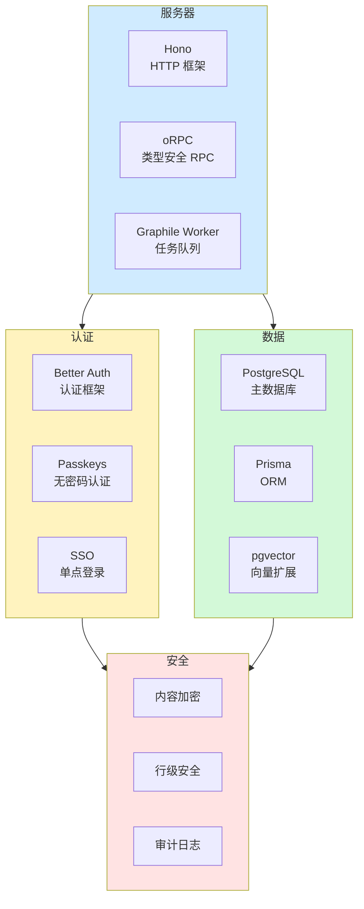

### 5.3 沙箱提供商对比

| 提供商 | 类型 | 特点 | 适用场景 |
|--------|------|------|----------|
| **Docker** | 本地 | 免费、完全控制 | 开发、私有部署 |
| **E2B** | 云端 | 快速启动、隔离 | 生产环境 |
| **Daytona** | 云端 | 开发环境 | 开发协作 |
| **CreateOS** | 云端 | 桌面环境 | 需要 GUI |
| **Boat** | 云端 | 持久化 | 长期任务 |
| **Railway** | 云端 | 集成部署 | Railway 用户 |

---

## 六、部署架构

### 6.1 自托管部署图

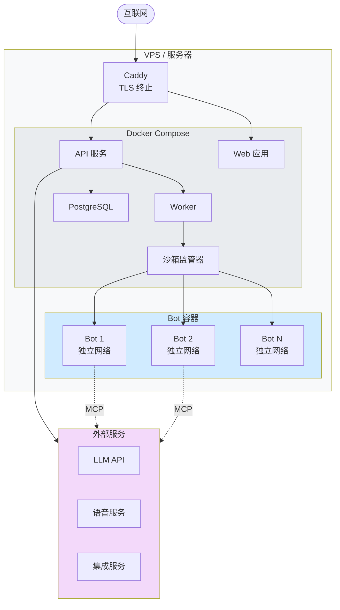

### 6.2 开发环境结构

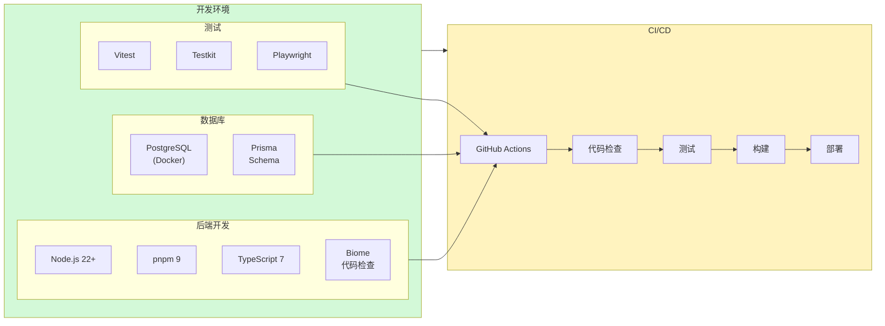

---

## 七、数据模型

### 7.1 核心实体关系图

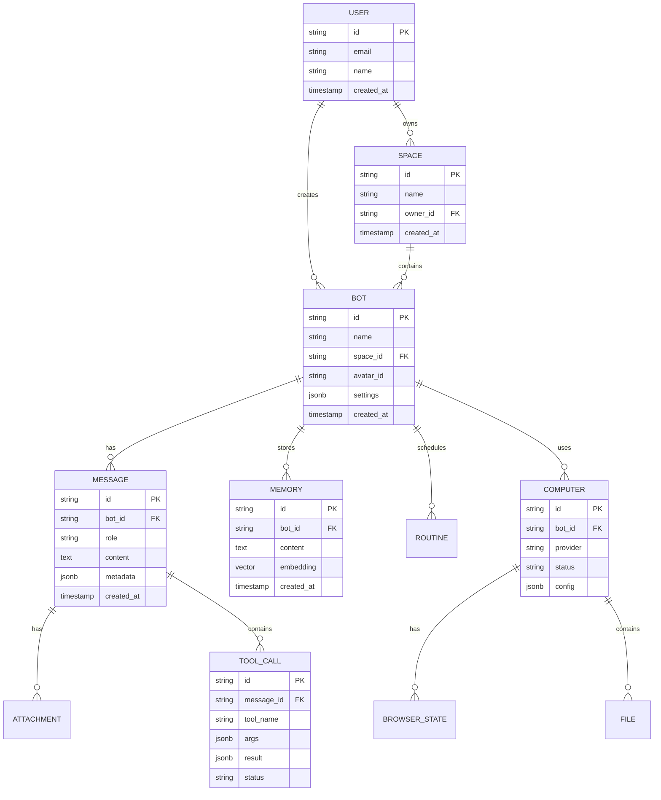

### 7.2 配置管理流程

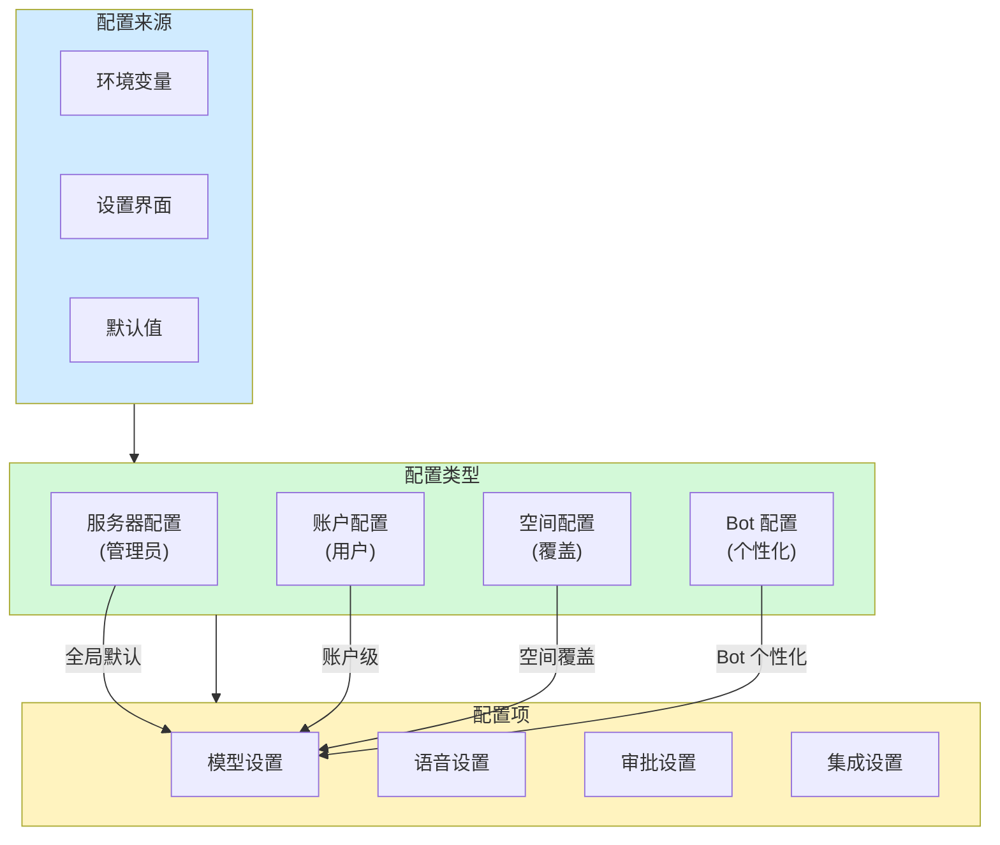

---

## 八、与竞品对比

### 8.1 架构对比图

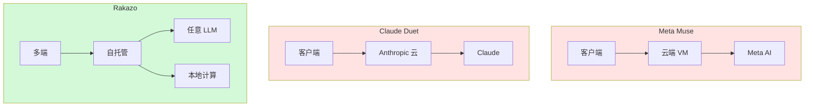

### 8.2 功能对比表

| 特性 | Meta Muse | Claude Duet | Rakazo |
|------|-----------|-------------|--------|
| **开源** | ❌ | ❌ | ✅ Apache-2.0 |
| **自托管** | ❌ | ❌ | ✅ |
| **模型选择** | Meta AI | Claude | 任意 LLM |
| **数据控制** | 云端 | 云端 | 用户控制 |
| **持久化 Bot** | ✅ | ✅ | ✅ |
| **语音** | ✅ | ✅ | ✅ 多供应商 |
| **桌面控制** | ❌ | ✅ | ✅ |
| **浏览器** | ❌ | ✅ | ✅ |
| **多端** | ✅ | ✅ | ✅ Web/Desktop/Mobile |
| **Bot 委托** | ❌ | ❌ | ✅ |
| **集成** | 有限 | MCP | Composio + Pipedream + MCP |
| **沙箱选择** | 单一 | 单一 | Docker/E2B/Daytona/... |

---

## 九、开发指南

### 9.1 项目结构

```
rakazo-main/
├── apps/                    # 应用程序
│   ├── api/                # API 服务 (Hono)
│   ├── web/                # Web 应用 (React + Vite)
│   ├── desktop/            # Electron 桌面应用
│   ├── mobile/             # Expo 移动应用
│   ├── worker/             # 后台任务 (Graphile)
│   └── www/                # 营销网站 (Astro)
├── packages/               # 共享包
│   ├── core/              # 核心业务逻辑
│   ├── contracts/         # 类型契约
│   ├── db/                # Prisma Schema
│   ├── auth/              # 认证逻辑
│   ├── memory/            # 记忆系统
│   ├── adapters/          # 外部服务适配器
│   ├── ui-web/            # Web UI 组件
│   ├── ui-tokens/         # 设计令牌
│   ├── chat-ui/           # 聊天 UI 组件
│   └── testkit/           # 测试工具
├── infra/                  # 基础设施
│   ├── compose/           # Docker Compose 配置
│   ├── sandboxes/         # 沙箱镜像
│   ├── railway/           # Railway 部署
│   └── systemd/           # Systemd 服务
├── scripts/                # 构建脚本
├── docs/                   # 文档
└── examples/               # 示例
```

### 9.2 开发命令

```bash
# 安装依赖
pnpm install

# 构建沙箱镜像
pnpm sandbox:build

# 启动开发环境
pnpm dev

# 代码检查
pnpm lint
pnpm check

# 测试
pnpm test                    # 单元测试
pnpm test:integration        # 集成测试
pnpm test:e2e               # E2E 测试

# 桌面应用开发
pnpm --filter @rakazo/desktop dev

# 数据库
pnpm db:generate            # 生成 Prisma 客户端
pnpm db:migrate             # 运行迁移

# 构建
pnpm build
```

### 9.3 添加新适配器

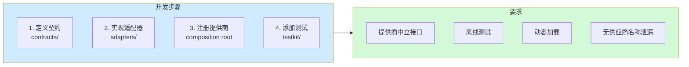

---

## 十、路线图

### 10.1 发展规划

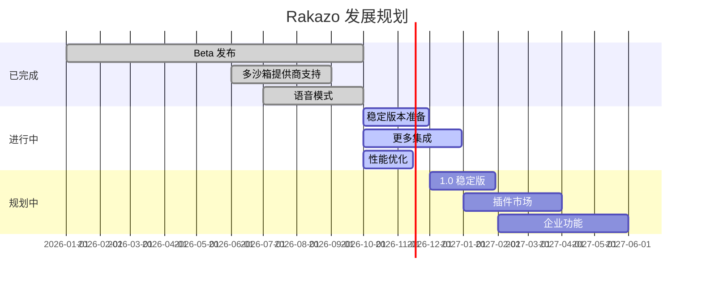

### 10.2 功能优先级

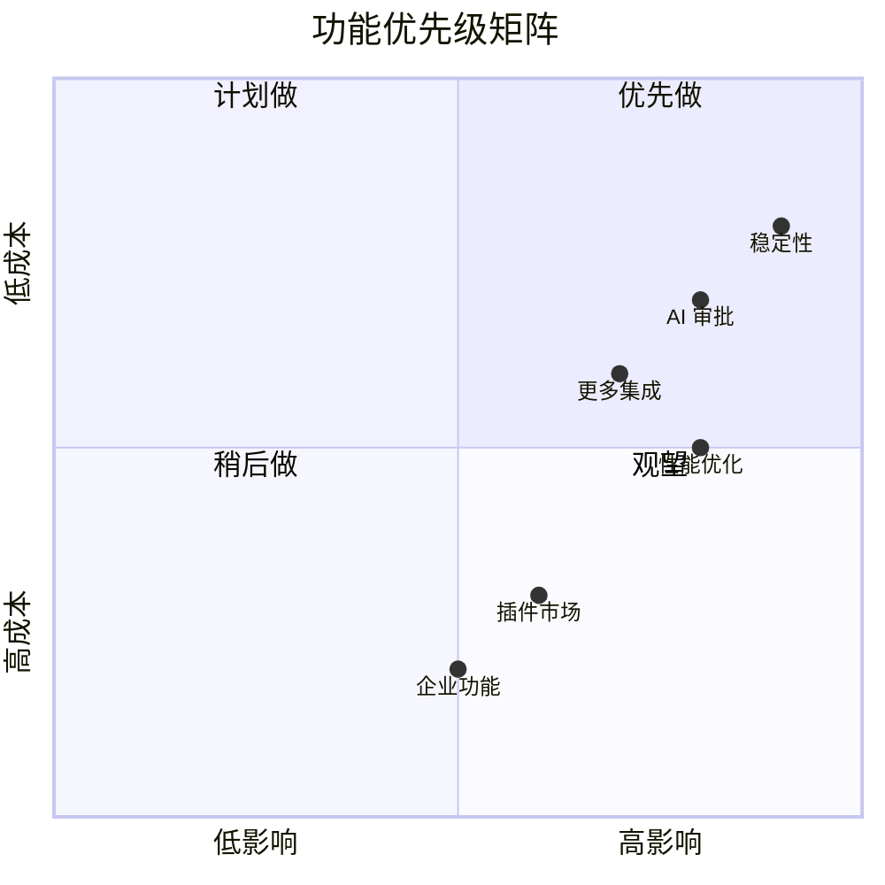

---

## 十一、总结与建议

### 11.1 SWOT 分析

```mermaid
graph TB
    subgraph SWOT["SWOT 分析"]
        subgraph S["优势"]
            S1[完全开源 Apache-2.0]
            S2[自托管、数据可控]
            S3[提供商中立]
            S4[Monorepo 架构清晰]
            S5[多沙箱提供商]
        end
        
        subgraph W["劣势"]
            W1[仍在 Beta]
            W2[复杂度高]
            W3[依赖较多外部服务]
        end
        
        subgraph O["机会"]
            O1[AI Agent 市场增长]
            O2[数据隐私需求]
            O3[企业自托管需求]
        end
        
        subgraph T["威胁"]
            T1[大厂竞争]
            T2[技术栈复杂]
            T3[社区规模]
        end
    end
    
    style S fill:#d3f9d8
    style W fill:#fff3bf
    style O fill:#d0ebff
    style T fill:#ffe3e3
```

### 11.2 项目亮点

1. **真正的开源替代**: Apache-2.0 协议，可商用
2. **完整的自托管方案**: 不需要任何外部服务即可运行
3. **提供商中立**: 不绑定任何 LLM 或沙箱提供商
4. **持久化 Bot**: 真正的 AI 队友，不是一次性对话
5. **多端统一**: Web/Desktop/Mobile 共享核心逻辑

### 11.3 集成建议

对于个人代理扩展项目 (`personal-agent-ext`)，可以借鉴：

1. **Monorepo 架构**: 使用 packages 分离关注点
2. **契约优先设计**: contracts 包定义清晰的接口
3. **适配器模式**: adapters 包实现提供商中立
4. **审批系统**: 三模式审批 (Never/Auto/Ask)
5. **沙箱抽象**: 统一的沙箱接口支持多提供商

### 11.4 关键文件索引

| 功能 | 文件路径 | 说明 |
|------|----------|------|
| API 入口 | `apps/api/src/` | Hono + oRPC |
| 核心逻辑 | `packages/core/src/` | Agent、审批、技能 |
| 类型契约 | `packages/contracts/src/` | 共享类型定义 |
| 数据库 | `packages/db/` | Prisma Schema |
| 适配器 | `packages/adapters/src/` | 外部服务适配 |
| UI 组件 | `packages/ui-web/` | shadcn/ui 组件 |
| 沙箱配置 | `infra/sandboxes/` | Docker 镜像 |
| 部署配置 | `infra/compose/` | Docker Compose |

---

## 附录

### A. 相关资源

| 资源 | 链接 |
|------|------|
| GitHub | https://github.com/elie222/rakazo |
| 官网 | https://rakazo.com |
| Discord | https://discord.gg/RWwKa2Sn7h |
| App Store | https://apps.apple.com/app/rakazo/id6801531099 |
| Google Play | https://play.google.com/store/apps/details?id=com.rakazo.app |

### B. 技术依赖

| 类别 | 技术 |
|------|------|
| **前端框架** | React 19, Vite, Tailwind CSS |
| **桌面** | Electron |
| **移动端** | Expo |
| **后端** | Hono, oRPC |
| **数据库** | PostgreSQL, Prisma |
| **认证** | Better Auth |
| **任务队列** | Graphile Worker |
| **代码质量** | Biome, TypeScript |
| **测试** | Vitest, Playwright |
| **构建** | Turbo, pnpm |

### C. 致谢

- PromptLayer
- Inbox Zero
- ConnectorMap
- CodeRabbit
- Greptile
- Snyk

---

*报告完成 - 包含 Mermaid 架构图、流程图、时序图、ER 图等可视化内容*
